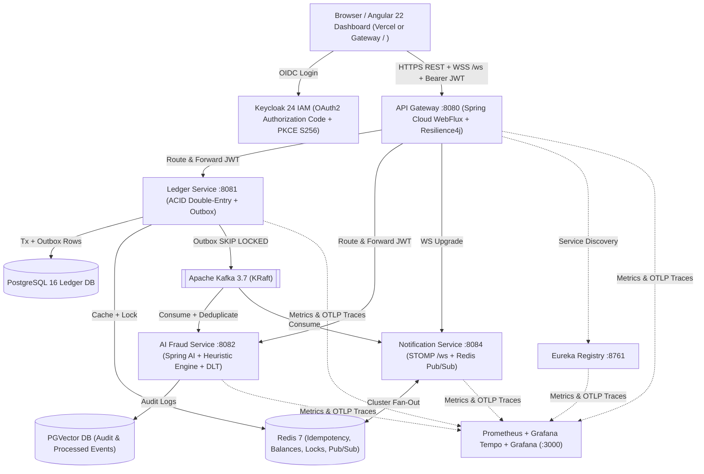
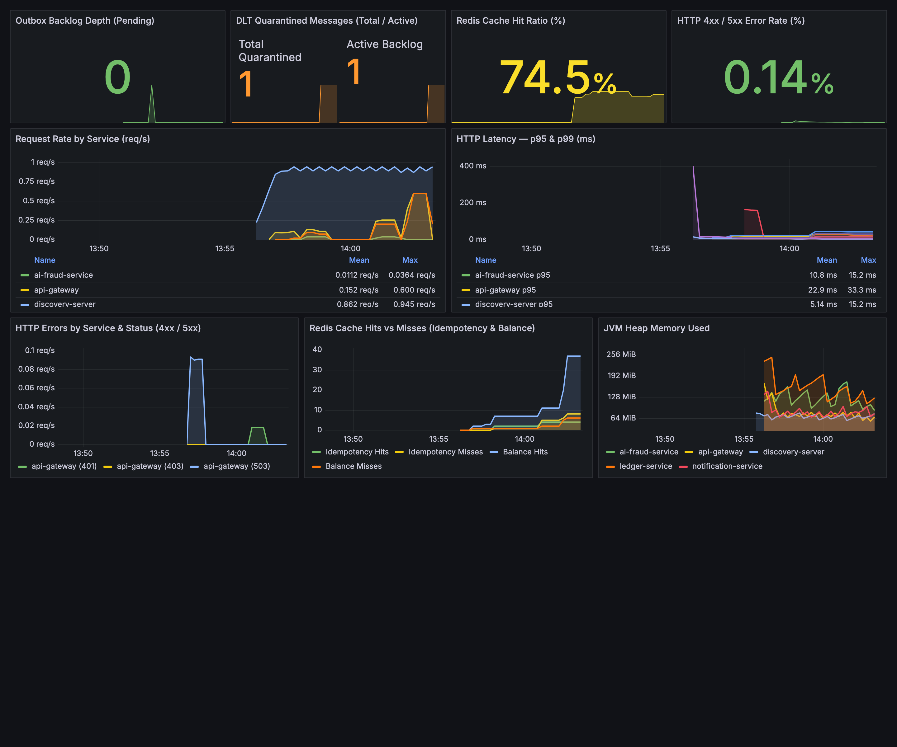
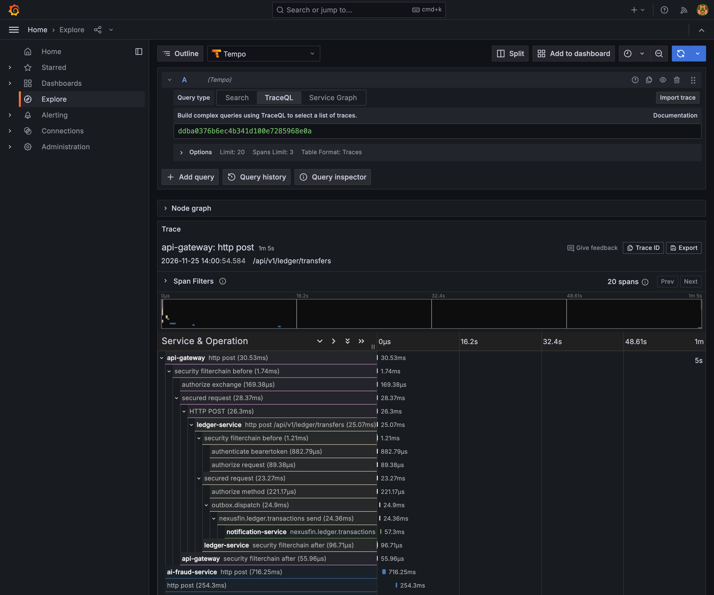

# NexusFin AI

**Cloud-native, event-driven banking ledger and real-time fraud platform built with Java 21 Virtual Threads, Spring Boot 3.2, Apache Kafka, PostgreSQL 16, Redis, Keycloak PKCE, and Angular 22.**

> Strictly enforces double-entry accounting invariants ($\sum \text{Debits} = \sum \text{Credits}$), deterministic batch pessimistic row locking (`ORDER BY id ASC`), transactional outbox publishing (`SKIP LOCKED`), idempotent Kafka consumers with `.DLT` quarantine, Redis caching + `SET NX` in-flight locks, OpenTelemetry/Prometheus observability, and real-time STOMP WebSocket push updates.

---

## 1. Architecture Overview



---

## 2. Run Locally in 2 Commands

```bash
cp .env.example .env
docker compose up -d
```

- **Angular Dashboard UI + API Gateway:** `http://localhost:8080`
- **Keycloak SSO Realm (`nexusfin`):** `http://localhost:8083` (`admin1` / `admin_password` for `ADMIN`; `customer1` / `customer_password` for `CUSTOMER`)
- **Eureka Dashboard:** `http://localhost:8761`

With observability enabled ([Prometheus](http://localhost:9090), [Grafana `admin`/`admin`](http://localhost:3000), Tempo):

```bash
docker compose -f docker-compose.yml -f docker-compose.observability.yml up -d
```

### Deploy Free on Vercel (Interactive Sandbox UI, \$0 Cloud Server Required)

You can deploy [`frontend/`](frontend/) directly to **Vercel** in 3 steps with **zero backend servers or paid cloud accounts**:
1. Push this repository to GitHub and open **Vercel -> Add New Project**.
2. Set **Root Directory** to **`frontend`** (uses [`frontend/vercel.json`](frontend/vercel.json), `npm run build:vercel`, output `dist/frontend/browser`).
3. Click **Deploy** (leave environment variables empty for automatic **Vercel Interactive Sandbox Mode** with simulated double-entry accounts, idempotent transfers, live STOMP feed updates, heuristic Fraud Console, and `.DLT` replay—clearly labeled with a sandbox banner).

### Optional: Full-Stack Cloud Deployment (Vercel Frontend + Oracle Cloud Free ARM64 Backend)

See [`docs/DEPLOYMENT_OCI_VERCEL.md`](docs/DEPLOYMENT_OCI_VERCEL.md) if you want to pair Vercel with an **OCI Ampere A1 (`4 OCPUs`, `24 GB RAM`)** backend using [`infra/terraform/`](infra/terraform/), [`docker-compose.oci.yml`](docker-compose.oci.yml), Caddy TLS, and [`.github/workflows/cd.yml`](.github/workflows/cd.yml).

---

## 3. Core Capabilities & Implementation Status

| Capability | Status | Implementation Summary |
| :--- | :--- | :--- |
| **GAAP/IFRS Double-Entry Ledger** | **Implemented** | Multi-leg balanced debit/credit validation ($\sum \text{Debits} = \sum \text{Credits}$), non-negative balance checks, immutable entries. |
| **Deadlock-Free Pessimistic Locking** | **Implemented** | Deterministic ascending UUID batch row locking (`findAllByIdsWithPessimisticLock` with `SELECT ... FOR UPDATE`). |
| **Idempotency & In-Flight Locks** | **Implemented** | DB unique constraint on `idempotency_key` backed by Redis cache + `SET NX` concurrent-flight guard. |
| **Transactional Outbox (`SKIP LOCKED`)** | **Implemented** | Atomic outbox rows polled via `PESSIMISTIC_WRITE` + `SKIP LOCKED` with synchronous Kafka dispatch & W3C traceparent replay. |
| **AI Fraud & Heuristic Fallback** | **Implemented** | Spring AI ChatClient with strict JSON schema parsing and deterministic millisecond fallback heuristics when no production OpenAI key is configured. |
| **Dead-Letter Topic Quarantine** | **Implemented** | Non-retryable poison-pill routing to `nexusfin.ledger.transactions.DLT`, `/api/v1/fraud/dlt/messages` inspection, and one-click replay. |
| **Keycloak OAuth2 / OIDC PKCE** | **Implemented** | Gateway + service-level JWT validation (supports Docker & browser issuers), `ADMIN`/`CUSTOMER` RBAC, and tenant `owner_id` isolation. |
| **WebSocket/STOMP Live Feed** | **Implemented** | Authenticated `/ws` endpoint, `/topic/transactions` (`ADMIN`), `/user/queue/transactions` (`CUSTOMER`), Redis Pub/Sub fan-out. |
| **Observability Stack** | **Implemented** | Prometheus `/actuator/prometheus`, OpenTelemetry OTLP to Grafana Tempo, JSON logs (`traceId`, `spanId`, `X-Correlation-Id`), provisioned Grafana dashboards. |
| **k6 Load Test Suite** | **Implemented** | Automated `k6` scripts (`perf/`) covering unique, opposing hot-pair, 80/20 mixed, and idempotency replay workloads. |
| **Angular 22 Dashboard** | **Implemented** | Standalone UI (`frontend/`) behind Gateway or Vercel with PKCE login, Accounts drilldown, Transfer UUID protection, Live STOMP feed, Fraud Console. |
| **OCI ARM64 IaC & GHCR CD** | **Implemented** | Terraform for Oracle Always Free `VM.Standard.A1.Flex`, Caddy TLS overlay, Vercel config script, multi-arch GHCR release pipeline. |

---

## 4. Measured Performance Summary ([`BENCHMARKS.md`](docs/benchmarks/BENCHMARKS.md))

Measured via `k6 v2.4.0` on Apple M4 (4 Docker vCPUs / 3.81 GiB container RAM ceiling) against live PostgreSQL 16 + Kafka 3.7 + Redis 7 + Keycloak (`0` errors across all benchmark transactions):

| Workload | VUs | Throughput | Avg Latency | p95 Latency | p99 Latency | Check Pass |
| :--- | :---: | :---: | :---: | :---: | :---: | :---: |
| **Unique Transfers** (`12,027` tx) | 12 | **395.64 req/s** | `29.86 ms` | `63.51 ms` | `98.94 ms` | **100.00%** |
| **Opposing Hot-Pair `A <-> B`** (`16,547` tx) | 12 | **547.99 req/s** | `21.68 ms` | `48.83 ms` | `70.92 ms` | **100.00%** (`0` deadlocks) |
| **Mixed 80/20 Read/Write** (`Redis ON` vs `OFF`) | 16 | **1,036.78 req/s** (`+23.2%`) | `15.25 ms` | `37.86 ms` (`-31.0%`) | W: `57.45 ms` (`-46.7%`) | **100.00%** |
| **Duplicate Idempotency Replay** (`22,144` ops) | 20 | **1,095.09 req/s** | `17.99 ms` | `37.25 ms` | `60.18 ms` | **100.00%** |





---

## 5. Multi-Module Repository Structure

```text
nexusfin-ai/
├── pom.xml                                  # Parent POM (Java 21, Spring Boot 3.2.5, Spring Cloud 2023, Spring AI 0.8.1)
├── docker-compose.yml                       # Full 11-container local development stack
├── docker-compose.observability.yml         # Prometheus, Grafana Tempo, and Grafana dashboards overlay
├── docker-compose.oci.yml                   # Oracle Cloud Always Free ARM64 + Caddy TLS production overlay
├── .github/workflows/
│   ├── ci.yml                               # Backend tests (Testcontainers), Angular Vitest+build, Compose lint, live E2E
│   └── cd.yml                               # Tagged v* multi-arch (linux/amd64, linux/arm64) GHCR push & GitHub Release
├── discovery-server/                        # Netflix Eureka registry (:8761)
├── api-gateway/                             # Spring Cloud Gateway WebFlux, Resilience4j, PKCE JWT validation (:8080)
├── ledger-service/                          # ACID double-entry engine, deterministic locking, outbox, Redis cache (:8081)
├── ai-fraud-service/                        # Dual Spring AI + heuristic engine, idempotent consumer, DLT replay (:8082)
├── notification-service/                    # Authenticated STOMP WebSocket + Redis Pub/Sub fan-out (:8084)
├── frontend/                                # Angular 22 standalone SPA, Vitest specs, Nginx & Vercel deploy config
├── perf/                                    # k6 load tests + measured benchmark scripts
└── infra/
    ├── keycloak/                            # Pre-configured OAuth2 / OIDC nexusfin realm import
    ├── observability/                       # Prometheus, Tempo, and Grafana provisioning configs
    ├── oci/                                 # Caddyfile & Keycloak Vercel redirect registration helper
    └── terraform/                           # Oracle Cloud Always Free ARM64 VCN, Security List & Ampere A1 IaC
```

---

## 6. Security Model & Known Limitations

### Security Model
- **Zero-Trust JWT Defense-in-Depth:** Both `api-gateway` (WebFlux reactive resource server) and downstream services (`ledger-service`, `notification-service`) cryptographically verify Keycloak RSA signatures against `jwk-set-uri` while permitting both browser PKCE issuers and internal Docker issuers.
- **Role-Based Access Control (RBAC):** `CUSTOMER` users can query only accounts matching their JWT `sub`/`owner_id` and submit transfers from owned accounts; `ADMIN` users have global visibility, account provisioning (`POST /api/v1/accounts`), `/topic/transactions`, fraud audit logs (`/api/v1/fraud/audit-logs`), and `.DLT` replay controls.
- **No Blind Mutation Retries:** Gateway Resilience4j retry filters explicitly apply only to idempotent `GET` endpoints—never `POST` transfers.

### Known Limitations
- **PGVector Semantic Similarity Search:** Audit logs persist in PostgreSQL 16 (`pgvector/pgvector:pg16` image is provisioned), while vector embedding generation for cross-transaction AML clustering remains unimplemented.
- **Vercel Preview Subdomains:** Keycloak 24 rejects middle-of-host wildcards (`https://*.vercel.app/*`); production origins must be registered explicitly via [`register-vercel-redirect.sh`](infra/oci/register-vercel-redirect.sh).
- **Cloud Provisioning:** [`infra/terraform/`](infra/terraform/) and [`docker-compose.oci.yml`](docker-compose.oci.yml) are validated locally (`terraform`/`docker compose config`) and await your live OCI account & Vercel project deployment.

---

## 7. Architecture Decision Records (ADRs)

- [`ADR-001`](docs/adr/ADR-001-virtual-threads-architecture.md) — Java 21 Virtual Threads Across Microservices
- [`ADR-002`](docs/adr/ADR-002-deterministic-pessimistic-locking.md) — Deadlock-Free Deterministic Ascending Pessimistic Locking
- [`ADR-003`](docs/adr/ADR-003-transactional-outbox-event-streaming.md) — Transactional Outbox Pattern with `SKIP LOCKED`
- [`ADR-004`](docs/adr/ADR-004-gateway-resilience-circuit-breakers.md) — Reactive API Gateway Resilience4j Circuit Breakers & Bulkheads
- [`ADR-005`](docs/adr/ADR-005-keycloak-oauth2-resource-server.md) — Keycloak OAuth2 / OIDC PKCE & Tenant Ownership Isolation
- [`ADR-006`](docs/adr/ADR-006-redis-caching-idempotency.md) — Redis Read-Through Caching & Distributed `SET NX` Locks
- [`ADR-007`](docs/adr/ADR-007-realtime-websocket-stomp-redis-fanout.md) — Real-Time STOMP WebSockets & Redis Pub/Sub Fan-Out
- [`ADR-008`](docs/adr/ADR-008-full-stack-observability-prometheus-otel.md) — Full-Stack Observability (Prometheus, Grafana Tempo, OTel & JSON Logs)

---

## 8. Running Tests

```bash
# Full backend unit + Testcontainers integration suite (requires Docker)
./mvnw clean test --batch-mode

# Angular unit tests (Vitest) + production build
cd frontend && npm ci && npm test -- --watch=false && npm run build
```

Licensed under the [MIT License](LICENSE). Contributions welcome—see [`CONTRIBUTING.md`](CONTRIBUTING.md).
